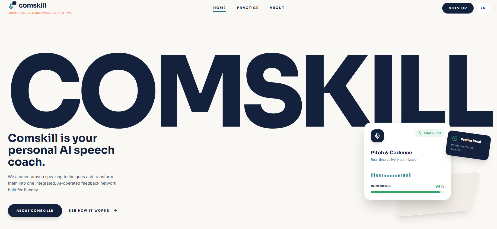

# Comskill

**Practice speaking out loud, see how you sound, and watch yourself improve.**

Comskill is a web app for anyone who wants to speak with more clarity and confidence. You record yourself in the browser, and Comskill measures how you delivered it: your pace, your filler words, your pauses and how steady you were. It also gives you a transcript and plain-language coaching on what went well and what to work on. Over time, an analytics view shows whether those habits are actually changing.

Comskill gives you something to practise *against*: specific numbers from your own recordings, and a clear next thing to fix.



---

## Why I built it

I built Comskill because I wanted to get better at communicating myself. I'm not where I want to be yet, but I'm a long way from where I started, and what moved me forward was practising, listening back, and fixing one thing at a time. This project turns that routine into a tool.

## What it does

- **Record in the browser.** Camera and microphone, with a countdown, a timer and takes of up to 15 minutes. Your video stays on your device until you choose to save it.
- **Measured feedback.** Pace in words per minute, filler words per minute, long silences, pace steadiness and repeated words, each checked against a comfortable range.
- **Plain-language coaching.** Strengths, things to work on (with clickable timestamps that jump the video to the moment), and written coaching from an AI model.
- **Transcript.** A full transcript of every analyzed recording.
- **Progress over time.** The Analytics page compares your latest sessions with your earlier ones, shows trends for each measure, and surfaces the habits that keep coming up.
- **My recordings.** Every saved take, newest first, with playback and delete.
- **Lessons and resources.** Short lessons with progress tracking, plus a Resources page of guides, practice drills and links to trusted outside material.
- **Accounts.** Email and password sign up, with Google and Facebook sign in. Sign up requires accepting the Terms and Privacy pages.
- **Plus:** a "How it works" walkthrough, Privacy and Terms pages, and a contact form.

Recordings are private to your account. A recording is only sent for analysis when you ask for it.

## How it works

1. **Record.** The browser records your video with the MediaRecorder API.
2. **Save.** The file is uploaded to private storage and linked to your account.
3. **Analyze.** On request, the audio is transcribed with word timings. The timings produce the measurements, and an AI coaching step writes the feedback from the transcript and numbers.
4. **Review and track.** Results are stored, so the Analytics page can compare sessions over time.

## Tech stack

| Area | Choice |
| --- | --- |
| Framework | [Next.js](https://nextjs.org/) (App Router) |
| Language | TypeScript / React |
| Styling | [Tailwind CSS](https://tailwindcss.com/) |
| Database | PostgreSQL on [Supabase](https://supabase.com/), accessed with [Prisma](https://www.prisma.io/) |
| Authentication | Supabase Auth (email, Google, Facebook) |
| File storage | Supabase Storage (private bucket, short-lived signed links) |
| Transcription | [AssemblyAI](https://www.assemblyai.com/) |
| Written coaching | AI model through OpenRouter or Groq (switchable) |
| Icons | [lucide-react](https://lucide.dev/) |
| Fonts | Sora (headings) and Inter (body) via Google Fonts |

## Getting started

### Prerequisites

- Node.js 18.18 or newer
- npm, pnpm or yarn
- A Supabase project
- An AssemblyAI API key
- An OpenRouter or Groq API key for the written coaching

### Installation

```bash
git clone <your-repo-url>
cd comskill
npm install
```

### Environment variables

Create a `.env` file in the project root:

| Variable | Purpose |
| --- | --- |
| `DATABASE_URL` | Pooled Postgres connection string. Ends with `?pgbouncer=true&schema=comskill` |
| `DIRECT_URL` | Direct Postgres connection string, used by the Prisma CLI |
| `NEXT_PUBLIC_SUPABASE_URL` | Your Supabase project URL |
| `NEXT_PUBLIC_SUPABASE_ANON_KEY` | Supabase anon (publishable) key. Safe for the browser |
| `SUPABASE_SERVICE_ROLE_KEY` | Supabase service role key. **Server only, never expose it** |
| `ASSEMBLYAI_API_KEY` | Transcription |
| `COACH_PROVIDER` | `openrouter` or `groq` |
| `OPENROUTER_API_KEY`, `OPENROUTER_MODELS` | If using OpenRouter |
| `GROQ_API_KEY`, `GROQ_MODELS` | If using Groq |
| `RESEND_API_KEY`, `CONTACT_TO_EMAIL` | Optional. Email alert for each contact message |

### Supabase setup

1. **Storage:** create a **private** bucket named `recordings` and set its file size limit (the free plan allows up to 50 MB per file).
2. **Database:** the tables live in a separate `comskill` schema, so the project can share a Supabase project. Create them in the SQL editor to match `prisma/schema.prisma` (`Recording`, `LessonProgress`, `ContactMessage` and their enums), then run `npx prisma generate`.
3. **Auth:** enable the Email provider. For Google or Facebook, add each provider's keys. Set the Site URL to `http://localhost:3000` and add `http://localhost:3000/auth/callback` to the redirect URLs.
4. While developing, you can switch off **Confirm email** so sign ups don't wait on a confirmation message.

### Run the development server

```bash
npm run dev
```

Open [http://localhost:3000](http://localhost:3000) in your browser.

### Build for production

```bash
npm run build
npm run start
```

## Project structure

A simplified view. Folders in parentheses are Next.js route groups and don't appear in the URL.

```
.
├── app/
│   ├── page.tsx              # Landing page
│   ├── (dashboard)/          # Signed-in pages: practice, recordings, analytics, learning
│   ├── api/                  # recordings, analysis, learning and contact endpoints
│   ├── auth/                 # Sign in / sign up, and the OAuth callback
│   ├── about/  resources/  how-it-works/  contact/  privacy/  terms/
├── components/               # Navbar, Footer, Recorder, AnalyticsView and more
├── hooks/useRecorder.ts      # Browser recording, countdown, limits
├── lib/
│   ├── analysis/             # Measurements and rule-based insights
│   ├── supabase/             # Browser, server and session helpers
│   ├── auth.ts  prisma.ts  legal.ts  resources.ts
├── prisma/schema.prisma
├── proxy.ts                  # Keeps sessions fresh and protects signed-in pages
└── public/                   # Static assets
```

## Design system

**Colours**

| Name | Hex | Use |
| --- | --- | --- |
| Navy | `#14213D` | Text, primary buttons, wordmark |
| Teal | `#1F7A8C` | Logo mic, waveform, links |
| Green | `#2FA66A` | Positive status, progress |
| Coral | `#FF7A59` | Accent, tagline, record button |
| Cream | `#FAF8F5` | Page background |
| Sand | `#EFEAE2` | Tracks, plates, subtle fills |
| Slate | `#4A5568` | Body copy |

**Typography**

- **Sora** (600 to 800) for headings, navigation and buttons
- **Inter** (400 to 600) for body copy and small labels

## Privacy and data

- Recordings are stored in a private bucket and played back through links that expire after an hour.
- Analysis only runs when you press Analyze. Audio goes to the transcription service, and the transcript and measurements go to the coaching model. The video does not.
- You can delete any recording from its page, which removes the video file and its analysis.

See the in-app Privacy and Terms pages for the full details.

## Notes for contributors

- Keep generated values out of render. Using `Math.random()` inside a component causes hydration mismatches in Next.js, so use fixed data instead.
- Sora's heaviest weight is 800. `font-black` (900) falls back to 800.
- Respect `prefers-reduced-motion` for any new animation.
- Keep interactive elements keyboard-focusable with a visible focus style.
- Add any new signed-in-only page to the `PROTECTED` list in `lib/supabase/session.ts`.
- If Tailwind classes in a brand-new file don't apply, stop the dev server, delete the `.next` folder and start it again.

## Roadmap

- [x] Mobile navigation menu
- [x] Practice flow (record, analyze, review)
- [x] Authentication
- [x] Feedback history and progress tracking
- [x] Lessons and resources
- [ ] Follow-up questions after a recording
- [ ] Self-service account deletion
- [ ] Bot protection on sign in (CAPTCHA)
- [ ] Automated tests
- [ ] Multi-language support (the EN selector is in place)

## Author

Built by **Kelvin Kipchumba**.